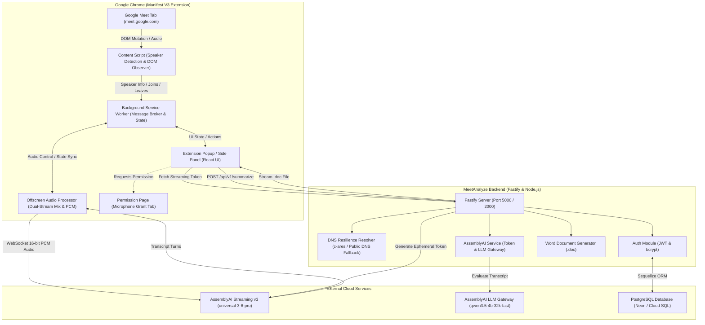

# MeetAnalyze (MeetLyst) — Project Overview

## 1. Project Purpose & Vision
**MeetAnalyze** (also referred to as **MeetLyst**) is an intelligent, full-stack meeting intelligence platform designed specifically for **Google Meet**. It combines a Manifest V3 Chrome Extension frontend with a Node.js/Fastify backend to provide:
1. **Real-time, continuous speech-to-text transcription** using AssemblyAI's flagship streaming models.
2. **Hybrid dual-stream speaker diarization and participant identity attribution** that dynamically resolves real human names from Google Meet's live DOM.
3. **Automated sales performance evaluation and meeting insights** powered by AssemblyAI's LLM Gateway using an executive 7-category evaluation rubric (`SALES_PROMPT`).
4. **Immediate executive Microsoft Word document (`.doc`) export**, formatting call assessments, scorecards, and action items for management coaching.
5. **Secure user authentication and workspace management** for sales teams and support agents.

---

## 2. Core Problem & Solution

### The Core Problem
Third-party speech-to-text transcription engines (such as AssemblyAI) receive raw audio. At best, audio-only diarization produces generic labels (`Speaker A`, `Speaker B`) with latency and no knowledge of attendee names, roles (Support Agent vs. Client), or attendance state. Furthermore, Google Meet's DOM markup uses dynamic, obfuscated classes that change unpredictably.

### The MeetAnalyze Solution
MeetAnalyze introduces a **Hybrid Dual-Stream Audio & DOM Observation Architecture**:
- **Hardware Separation**: Separately captures the local support agent's microphone via standard WebRTC `getUserMedia`, and the client/remote attendees' audio via Google Meet's tab capture (`chrome.tabCapture.getMediaStreamId`).
- **Real-Time Volume & Stream Analysis**: In an offscreen Web Audio pipeline, independent audio analyzers continuously determine whether the local agent or remote attendees are speaking.
- **Active DOM Observation**: A resilient Google Meet content script continuously tracks attendees, active speaker indicators (visualizer bars, aria attributes, blue speech borders), and join/leave notifications.
- **Timestamped Speaker Intervals & Retroactive Correction**: Utterances are correlated with DOM speaker intervals; even if speech is initially tagged generically, turns within a 6-second window are dynamically corrected once the speaker is confirmed.
- **On-Demand AI Sales Evaluation**: Post-call or mid-call, the complete transcript is analyzed by LLM models against a comprehensive sales coaching rubric, generating a downloadable `.doc` report.

---

## 3. High-Level System Architecture



---

## 4. Repository Structure & Key Directories

```
meetlyst/
├── backend/                       # Fastify backend service
│   ├── api/index.js               # Vercel serverless entrypoint
│   ├── config/                    # Database (pg-config.js) and environment settings
│   ├── src/
│   │   ├── constants/             # prompt.js (SALES_PROMPT), assembly.js
│   │   ├── controllers/           # assembly-ai.controller.js, auth.controller.js
│   │   ├── database/migrations/   # Sequelize database migrations
│   │   ├── models/                # user.js, user_roles.js, order.js, payment.js, product.js
│   │   ├── routes/                # assemblyai.routes.js, auth.routes.js, main.routes.js
│   │   ├── services/              # assembly.service.js, auth.service.js, user.service.js
│   │   ├── utils/                 # dns-resolver.js, doc-generator.js, sync-models.js
│   │   └── validators/            # auth.validator.js (Joi schemas)
│   ├── server.js                  # Main backend server entry point
│   ├── vercel.json                # Vercel deployment rewrites
│   └── package.json               # Backend dependencies
├── frontend/                      # Chrome Extension (WXT + React + Tailwind)
│   ├── entrypoints/
│   │   ├── background.ts          # Manifest V3 service worker & offscreen lifecycle
│   │   ├── content.ts             # Google Meet DOM speaker detection content script
│   │   ├── common/                # Shared TypeScript types.ts and constants.ts
│   │   ├── offscreen/             # Offscreen audio processor (index.html, main.ts)
│   │   ├── permission/            # Standalone permission grant page (main.tsx)
│   │   ├── popup/                 # Extension popup UI (App.tsx, main.tsx, style.css)
│   │   │   └── hooks/             # useRealtimeTranscription.ts
│   │   ├── sidepanel/             # Chrome side panel entrypoint (main.tsx)
│   │   └── utils/                 # meet-selectors.ts, check-google-meet-connection.ts
│   ├── public/                    # Extension icons and static assets
│   ├── wxt.config.ts              # WXT build configuration (Vite, Tailwind, Manifest)
│   └── package.json               # Frontend dependencies
├── docs/ai-context/               # Persistent AI Context & Knowledge System
├── package.json                   # Monorepo root workspace configuration
└── pnpm-workspace.yaml            # pnpm workspace definition
```

---

## 5. Summary of Main Modules

| Module | Location | Primary Responsibility |
| :--- | :--- | :--- |
| **Speaker Detection Engine** | [`frontend/entrypoints/content.ts`](file:///Users/aahil/Desktop/meetlyst/frontend/entrypoints/content.ts) | Observes Google Meet DOM; identifies attendees, active speakers, speaker timeline intervals, and join/leave events. |
| **Resilient Selectors** | [`frontend/entrypoints/utils/meet-selectors.ts`](file:///Users/aahil/Desktop/meetlyst/frontend/entrypoints/utils/meet-selectors.ts) | Houses decoupled CSS/attribute selectors, toast regex patterns, and UI blacklists for Meet DOM. |
| **Offscreen Audio Processor** | [`frontend/entrypoints/offscreen/main.ts`](file:///Users/aahil/Desktop/meetlyst/frontend/entrypoints/offscreen/main.ts) | Captures tab & mic streams, converts audio to 16-bit PCM, analyzes volume for speaker attribution, streams to AssemblyAI. |
| **Background Service Worker** | [`frontend/entrypoints/background.ts`](file:///Users/aahil/Desktop/meetlyst/frontend/entrypoints/background.ts) | Coordinates extension messaging, offscreen creation/destruction, and `chrome.storage.local` persistence. |
| **Extension UI** | [`frontend/entrypoints/popup/App.tsx`](file:///Users/aahil/Desktop/meetlyst/frontend/entrypoints/popup/App.tsx) | Live transcript view, participant chip display, manual rename modals, audio capture warning, and Insight download button. |
| **DNS Resilience Utility** | [`backend/src/utils/dns-resolver.js`](file:///Users/aahil/Desktop/meetlyst/backend/src/utils/dns-resolver.js) | Monkey-patches `dns.lookup` with 3-tier fallback to eliminate macOS Darwin `getaddrinfo ENOTFOUND` bugs. |
| **AssemblyAI Service** | [`backend/src/services/assembly.service.js`](file:///Users/aahil/Desktop/meetlyst/backend/src/services/assembly.service.js) | Generates streaming tokens and runs transcript sales evaluations via LLM Gateway (`qwen3.5-4b-32k-fast`). |
| **Word Document Generator** | [`backend/src/utils/doc-generator.js`](file:///Users/aahil/Desktop/meetlyst/backend/src/utils/doc-generator.js) | Translates markdown insights into styled Microsoft Word `.doc` files with tables, headers, and metadata. |
| **Auth & User Service** | [`backend/src/services/user.service.js`](file:///Users/aahil/Desktop/meetlyst/backend/src/services/user.service.js) | Handles user registration, password hashing (`bcrypt`), and session management (`jsonwebtoken`). |

