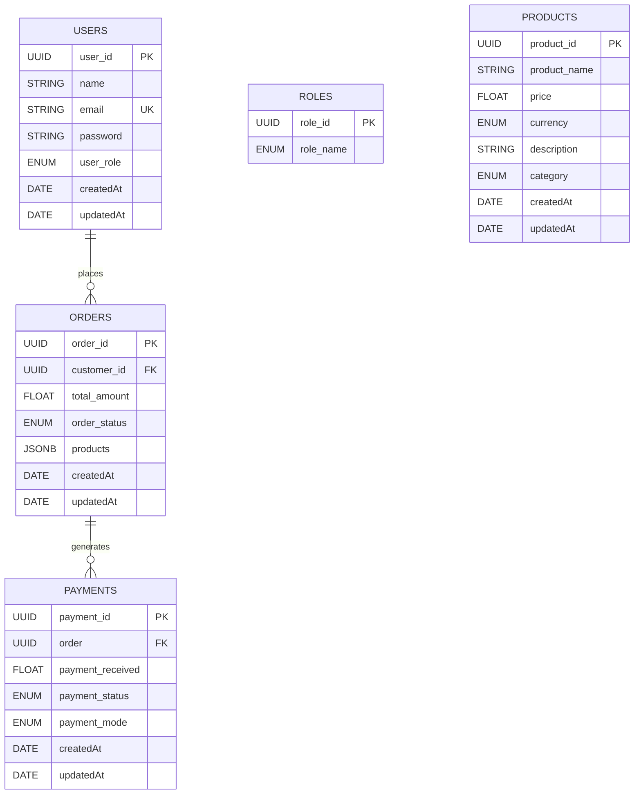
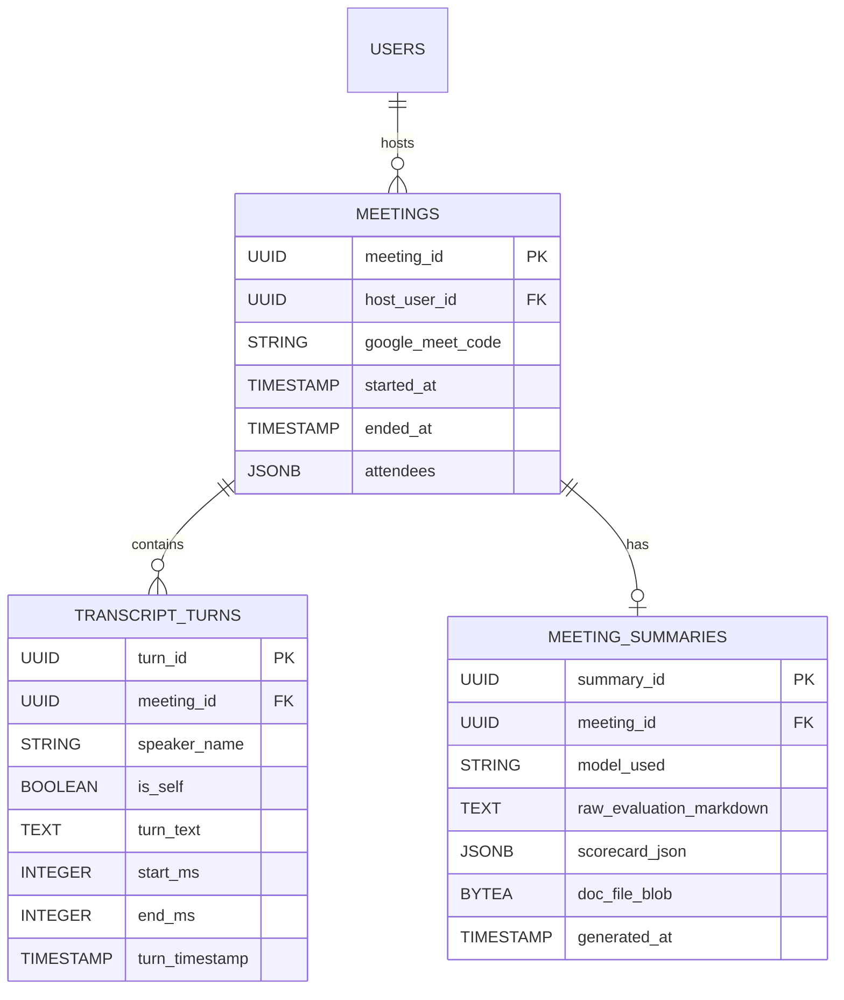

# MeetAnalyze (MeetLyst) — Database Schema & Data Models

## 1. Overview & Database Architecture
The backend uses **PostgreSQL** managed through **Sequelize ORM** (`sequelize` v6.37.x). 
The database configuration is housed in [`backend/config/pg-config.js`](file:///Users/aahil/Desktop/meetlyst/backend/config/pg-config.js).

### Connection Configuration
- **Connection Method**: Reads `process.env.DATABASE_URL`.
- **SSL Enforcement**: Configured with `ssl: { require: true, rejectUnauthorized: false }` to ensure compatibility with managed PostgreSQL providers (such as Neon, Supabase, or AWS RDS).
- **Connection Pool**:
  - `max`: 5 connections
  - `min`: 0 connections
  - `acquire`: 30,000 ms
  - `idle`: 10,000 ms
- **Synchronization**: Handled on server bootstrap via [`backend/src/utils/sync-models.js`](file:///Users/aahil/Desktop/meetlyst/backend/src/utils/sync-models.js) using:
  ```javascript
  await sequelize.sync({ alter: true, force: false });
  ```

---

## 2. Entity-Relationship Model



---

## 3. Detailed Model Definitions

### 3.1 User (`backend/src/models/user.js`)
Represents registered users (sales agents, support reps, administrators).

| Column | Type | Constraints | Default | Description |
| :--- | :--- | :--- | :--- | :--- |
| `user_id` | `UUID` | Primary Key, Unique | `UUIDV4` | Unique user identifier. |
| `name` | `STRING` | `allowNull: false` | None | Full display name of the user. |
| `user_role` | `ENUM('customer', 'admin')` | `allowNull: false` | `'customer'` | Authorization role level. |
| `email` | `STRING` | `allowNull: false`, Unique, `isEmail` | None | Unique login email address. |
| `password` | `STRING` | `allowNull: false` | None | Salted bcrypt hash of user password. |
| `createdAt` | `DATE` | Managed by Sequelize | `NOW` | Timestamp of account creation. |
| `updatedAt` | `DATE` | Managed by Sequelize | `NOW` | Timestamp of last record update. |

#### Model Hooks & Methods
- **Pre-Create Hook (`beforeCreate`)**:
  ```javascript
  user.password = await encryptPassword(user.password);
  ```
- **Instance Method (`validatePassword(plainPassword)`)**:
  ```javascript
  return await comparePassword(plainPassword, this.password);
  ```

---

### 3.2 UserRoles (`backend/src/models/user_roles.js`)
Reference table defining assignable system roles.

| Column | Type | Constraints | Default | Description |
| :--- | :--- | :--- | :--- | :--- |
| `role_id` | `UUID` | Primary Key, Unique | `UUIDV4` | Unique role identifier. |
| `role_name` | `ENUM('customer', 'admin')` | `allowNull: false` | `'customer'` | Role name descriptor. |

---

### 3.3 Boilerplate Domain Models
These models were inherited from the backend starter architecture and are currently present in the schema:

#### A. Order (`backend/src/models/order.js`)
- `order_id`: `UUID` (Primary Key).
- `customer_id`: `UUID` (Foreign key referencing `user.user_id`).
- `total_amount`: `FLOAT` (`allowNull: false`).
- `order_status`: `ENUM('delivered', 'shipped', 'processing')` (Default: `'processing'`).
- `products`: `JSONB` (`allowNull: false`) — JSON array of ordered product items.

#### B. Payment (`backend/src/models/payment.js`)
- `payment_id`: `UUID` (Primary Key).
- `order`: `UUID` (Foreign key referencing `order.order_id`).
- `payment_received`: `FLOAT` (Default: `0`).
- `payment_status`: `ENUM('paid', 'pending')`.
- `payment_mode`: `ENUM('cash-on-delivery', 'online-transfer')`.

#### C. Product (`backend/src/models/product.js`)
- `product_id`: `UUID` (Primary Key).
- `product_name`: `STRING` (`allowNull: false`).
- `price`: `FLOAT` (`allowNull: false`).
- `currency`: `ENUM('USD', 'PKR', 'INR')` (Default: `'PKR'`).
- `description`: `STRING` (`allowNull: false`).
- `category`: `ENUM('chair', 'sofa', 'cushion set', 'bar stool', 'dresser', 'cabinet')`.

---

## 4. Migrations
Located in [`backend/src/database/migrations/20251015205202-create-user.js`](file:///Users/aahil/Desktop/meetlyst/backend/src/database/migrations/20251015205202-create-user.js).
Creates the base `users` table with standard timestamps and UUID primary key.

---

## 5. Proposed Evolution: Meeting Intelligence Models
Currently, meeting transcripts are stored in Chrome extension storage (`chrome.storage.local`) and exported on demand as Word documents. When the backend is expanded to persist meeting history centrally, the following schema additions are recommended:



